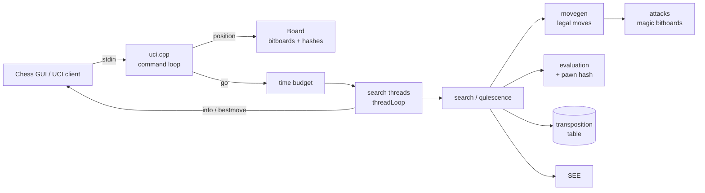

# AXIOM C++ Chess Engine

A **UCI-compatible chess engine written in C++17**, built around a bitboard board representation, magic-bitboard sliding-piece attacks, fully legal move generation, a modern alpha-beta search (PVS with a long list of pruning and reduction heuristics), a tapered hand-crafted evaluation, a transposition table, Lazy-SMP-style multithreading, and tournament-style time management.

The engine speaks the [Universal Chess Interface](https://www.shredderchess.com/download/div/uci.zip) over standard input/output, so it plugs straight into GUIs and match runners such as Cute Chess or Arena.

> Everything in this document was checked against the source in `bitboards/`. Where a feature is partial or has a known rough edge, it is called out explicitly in [Known limitations](#known-limitations) rather than glossed over.

---

## Table of contents

1. [Feature overview](#feature-overview)
2. [Quick start](#quick-start)
3. [Building](#building)
4. [Using the engine (UCI)](#using-the-engine-uci)
5. [Connecting to a GUI](#connecting-to-a-gui)
6. [Repository layout](#repository-layout)
7. [Architecture and internals](#architecture-and-internals)
   - [Board representation](#board-representation)
   - [Move encoding](#move-encoding)
   - [Attack generation and magic bitboards](#attack-generation-and-magic-bitboards)
   - [Move generation](#move-generation)
   - [Making and unmaking moves](#making-and-unmaking-moves)
   - [Zobrist hashing](#zobrist-hashing)
   - [Transposition table](#transposition-table)
   - [Static exchange evaluation (SEE)](#static-exchange-evaluation-see)
   - [Search](#search)
   - [Move ordering and history heuristics](#move-ordering-and-history-heuristics)
   - [Time management](#time-management)
   - [Multithreading](#multithreading)
   - [Pondering](#pondering)
   - [Evaluation](#evaluation)
8. [Testing and benchmarking](#testing-and-benchmarking)
9. [Regenerating magic numbers](#regenerating-magic-numbers)
10. [Legacy prototype (repository root)](#legacy-prototype-repository-root)
11. [Known limitations](#known-limitations)
12. [Troubleshooting](#troubleshooting)
13. [Author and license](#author-and-license)

---

## Feature overview

| Area | What is implemented |
|---|---|
| **Board** | 12 piece bitboards + white/black/occupied bitboards, 64-square mailbox (`pieceOn`), FEN import/export of the piece-placement field, incremental Zobrist and pawn hashes |
| **Move generation** | Fully **legal** generation (no pseudo-legal filtering): checker/pin detection, check masks, pin rays, en-passant discovered-check test, castling rules, all four promotion pieces; generation modes `ALL`, `CAPTURES`, `QUITE` (quiet) |
| **Sliding attacks** | Magic bitboards for rooks and bishops with precomputed magic numbers; `line[][]` and `between[][]` lookup tables |
| **Search** | Iterative deepening, aspiration windows, principal-variation search, quiescence search, triangular PV table, mate-distance pruning |
| **Pruning / reductions** | Null-move pruning, reverse futility, razoring, ProbCut, futility pruning, late-move pruning, SEE pruning, late-move reductions, internal iterative reduction |
| **Extensions** | Check extension, singular extension |
| **Move ordering** | TT move, SEE-aware capture scoring, killers, counter-moves, butterfly history, 1-ply continuation history, capture history |
| **Evaluation** | Tapered (mid/end game) PeSTO-style piece-square tables plus mobility, pawn structure (cached), king safety, rooks, threats, outposts, bishop pair, space, imbalance, and opposite-colour-bishop scaling; pawn-hash-indexed **correction history** on the static eval |
| **Draw detection** | Repetition, 50-move rule, insufficient material |
| **Transposition table** | Power-of-two sized, depth-preferred replacement, mate-score normalisation, resizable through the UCI `Hash` option |
| **Static exchange evaluation** | Iterative swap-list SEE with least-valuable-attacker and x-ray handling |
| **Time management** | Per-move budget from clocks, dynamic soft limit (best-move stability, score trend, node-share), "easy move" early exit, hard limit checked inside the search |
| **Parallel search** | Configurable thread count (`Threads`), per-thread state, shared transposition table |
| **Protocol** | UCI: `uci`, `isready`, `ucinewgame`, `position`, `go`, `setoption`, `stop`, `ponderhit`, `quit` |
| **Tooling** | Perft/divide routine, a perft-based `bench()` helper, and a standalone magic-number generator |

---

## Quick start

```bash
# 1. Build (Linux/macOS shown; see "Building" for Windows)
cd bitboards
g++ -O3 -std=c++17 -pthread \
    attacks.cpp bitboards.cpp board.cpp magic.cpp main.cpp makeMove.cpp \
    movegen.cpp perft.cpp zobrist.cpp uci.cpp search.cpp evaluation.cpp \
    see.cpp TT.cpp -o chess
# (main.cpp currently includes <windows.h>; remove that line on Linux/macOS.)

# 2. Talk to it
./chess
uci
setoption name Hash value 64
isready
position startpos
go movetime 2000
```

> **Important:** send `setoption name Hash value <MB>` before searching. The transposition table is only allocated when this option is set (see [Known limitations](#known-limitations)). GUIs normally send it for you if you set the Hash option in the engine configuration.

---

## Building

### Requirements

- A C++17 compiler (GCC/`g++` is what the project is built and tested with).
- A toolchain with `std::thread` support. On Linux/macOS pass `-pthread`. On Windows use a MinGW-w64/MSYS2 build with POSIX threads.
- Optionally, a UCI GUI such as [Cute Chess](https://cutechess.com/) or Arena.

C++17 is required (the search uses structured bindings such as `auto [prevPiece, prevTo] = ...`).

### Source files to compile

All engine sources live in `bitboards/`. Compile these 14 translation units together:

```
attacks.cpp  bitboards.cpp  board.cpp  magic.cpp  main.cpp  makeMove.cpp  movegen.cpp
perft.cpp    zobrist.cpp    uci.cpp    search.cpp  evaluation.cpp  see.cpp  TT.cpp
```

Do **not** add `generateMagic_numbers.cpp` or `benchmark.cpp` to the engine build: the first defines its own `main()` and duplicate symbols (it is a separate tool, see [Regenerating magic numbers](#regenerating-magic-numbers)); the second is a helper that is not referenced by the UCI loop.

### Windows (PowerShell)

```powershell
cd path\to\chess-engine-cpp\bitboards
g++ -O3 -std=c++17 attacks.cpp bitboards.cpp board.cpp magic.cpp main.cpp makeMove.cpp movegen.cpp perft.cpp zobrist.cpp uci.cpp search.cpp evaluation.cpp see.cpp TT.cpp -o chess.exe
.\chess.exe
```

If `g++` is not recognised, install MinGW-w64 (for example through MSYS2 or winlibs) and add its `bin` folder to `PATH`.

### Linux / macOS

`bitboards/main.cpp` includes `<windows.h>`, which does not exist on these platforms, and nothing in the file uses it. Delete that one line (or use the `main` below), then build with `-pthread`:

```cpp
// main.cpp (portable)
#include "uci.h"
#include <cstdio>
int main() {
    std::setvbuf(stdout, nullptr, _IONBF, 0); // unbuffered output for GUIs
    initUCI();
    return 0;
}
```

```bash
cd bitboards
g++ -O3 -std=c++17 -pthread attacks.cpp bitboards.cpp board.cpp magic.cpp main.cpp makeMove.cpp movegen.cpp perft.cpp zobrist.cpp uci.cpp search.cpp evaluation.cpp see.cpp TT.cpp -o chess
./chess
```

### Build notes

- `assert()` is used in `makeMove`/`unMakeMove` (ply bounds) and in the bit-scan helpers. They are active by default; add `-DNDEBUG` for a release build if you want them compiled out.
- `-march=native` is optional. The engine relies on `__builtin_popcountll`, `__builtin_ctzll` and `__builtin_bswap64`, which are GCC/Clang builtins, so MSVC is **not** supported without changes.
- Startup initialisation (attack tables, magic tables, Zobrist keys, evaluation tables, LMR table) runs inside the `Board` constructor, so a fresh start takes only a moment.

---

## Using the engine (UCI)

UCI is a line-oriented text protocol: type one command per line. The engine reads from standard input and writes to standard output.

### Supported commands

| Command | Behaviour |
|---|---|
| `uci` | Prints `id name`, `id author`, the three options below, then `uciok` |
| `isready` | Replies `readyok` |
| `ucinewgame` | Stops any search, resets to the start position, clears the transposition table and per-thread search state |
| `position startpos [moves ...]` | Sets the start position, then applies the given moves |
| `position fen <FEN> [moves ...]` | Loads a full FEN (all six fields), then applies the given moves |
| `go ...` | Starts a search (see [Search limits](#search-limits)). The search runs on background threads, so the engine stays responsive to `stop` |
| `stop` | Stops the search; the engine prints `bestmove` |
| `ponderhit` | Switches a pondering search to normal time control |
| `setoption name <Name> value <V>` | Sets `Threads` or `Hash` |
| `quit` | Stops any running search and exits |

A `position` command also stops any search that is still running.

### Options

| Option | Type | Default | Range | Effect |
|---|---|---|---|---|
| `Threads` | spin | 1 | 1 to 256 | Number of search threads |
| `Hash` | spin | 16 | 1 to 4096 | Transposition-table size in MB (rounded down to a power-of-two number of entries) |
| `Ponder` | check | false | n/a | Declared for GUI compatibility; see [Pondering](#pondering) |

`setoption` expects the option name to be a single word (`Threads`, `Hash`), which matches the options currently offered.

### Search limits

`go` accepts these parameters:

| Parameter | Meaning |
|---|---|
| `depth N` | Search to N plies. With no clock given, the time limit is effectively unlimited |
| `movetime T` | Search for T milliseconds |
| `wtime` / `btime` | Remaining clock time (ms) for White / Black |
| `winc` / `binc` | Increment per move (ms) |
| `movestogo N` | Moves until the next time control (default assumption: 30) |
| `infinite` | Search until `stop` (depth capped at 64) |
| `ponder` | Start a pondering search (see [Pondering](#pondering)) |

`go nodes`, `go mate`, and `searchmoves` are **not** implemented; unknown tokens are ignored.

Priority order when several are given: `infinite` > `movetime` > `depth` (without clocks) > clocks (a `depth` given alongside clocks acts as an extra depth cap).

### Move notation

Moves use coordinate notation: `e2e4`, `g1f3`, `e7e8q` (promotion piece is a lower-case letter). Castling is a king move (`e1g1`, `e1c1`, `e8g8`, `e8c8`). Illegal or malformed moves in a `position ... moves` list stop the move list at that point.

### Example session

```
> uci
id name
id author Pratham Mahajan
option name Threads type spin default 1 min 1 max 256
option name Hash type spin default 16 min 1 max 4096
option name Ponder type check default false
uciok
> setoption name Hash value 64
> isready
readyok
> position startpos moves e2e4 e7e5
> go movetime 1000
info depth 12 score cp 37 nodes ... nps ... time ... pv d2d4 e5d4 g1f3 ...
...
bestmove d2d4 ponder e5d4
> quit
```

### Search output

At the end of each completed iteration, thread 0 prints one `info` line:

```
info depth <d> score <cp <n> | mate <n>> nodes <n> nps <n> time <ms> pv <moves...>
```

Mate scores are reported as `mate N` (in moves), centipawn scores as `cp N`. The final line is `bestmove <move> [ponder <move>]`, where the ponder move is the second move of the principal variation when one exists.

---

## Connecting to a GUI

1. Build the engine and note the path to the executable (`chess.exe` / `chess`).
2. In your GUI's engine manager, add a new engine, choose that executable, and select the **UCI** protocol.
3. Open the engine options and set `Hash` (for example 64 or 128) and `Threads`. **Setting Hash explicitly matters** because the transposition table is not allocated otherwise.
4. Start a game or analysis session.

[Cute Chess](https://cutechess.com/) is particularly handy for engine-versus-engine testing. The repository's `.gitignore` already lists `cutechess-cli.exe` and engine binaries, which suggests match-testing builds against each other is part of the development workflow.

---

## Repository layout

```
chess-engine-cpp/
├── bitboards/                  ← the engine (everything you need to build and run)
│   ├── main.cpp                program entry point → initUCI()
│   ├── uci.h / uci.cpp         UCI parser, option handling, search launch, time budget
│   ├── search.h / search.cpp   alpha-beta search, quiescence, time management, thread loop
│   ├── evaluation.h / .cpp     tapered evaluation, pawn hash table, all eval terms
│   ├── movegen.h / .cpp        legal move generation, check/pin detection, attack queries
│   ├── makeMove.h / .cpp       make/unmake (incl. null move), pin helper
│   ├── board.hpp / board.cpp   Board class, FEN loading, start-up initialisation
│   ├── moves.h                 32-bit Move encoding and accessors
│   ├── types.h                 enums (Piece, Color, Castling, GenType, TTFlag), Undo struct
│   ├── bitboards.h / .cpp      Bitboard type, Square/File/Rank, bit helpers, printing
│   ├── attacks.h / .cpp        leaper tables, slider tables, line/between, pawn masks
│   ├── magic.h / .cpp          magic index function
│   ├── magic_nums.h            precomputed rook and bishop magic numbers
│   ├── zobrist.h / .cpp        Zobrist keys (xorshift64)
│   ├── TT.h / TT.cpp           transposition table
│   ├── see.h / see.cpp         static exchange evaluation
│   ├── perft.h / perft.cpp     perft and perft-divide
│   ├── benchmark.h / .cpp      perft-based speed benchmark helper (bench)
│   └── generateMagic_numbers.cpp   standalone tool that generated magic_nums.h
├── board.cpp, board.h, main.cpp,
│   move.h, piece.h, promotion.h    legacy mailbox prototype (not part of the engine)
├── .gitignore
└── README.md
```

---

## Architecture and internals



### Board representation

Defined in `board.hpp`. Squares are numbered **A1 = 0 … H8 = 63** (little-endian rank-file mapping: `square = rank * 8 + file`).

| Member | Meaning |
|---|---|
| `Bitboard pieces[12]` | One bitboard per piece: `WP, WN, WB, WR, WQ, WK, BP, BN, BB, BR, BQ, BK` |
| `whitePieces`, `blackPieces`, `occupied` | Aggregate occupancy, refreshed by `updateOccupancies()` |
| `std::array<Piece,64> pieceOn` | Mailbox for O(1) "what is on this square" |
| `sideToMove`, `castlingRights`, `enPassantSquare`, `halfMoveClock` | Standard state. Castling rights are bit flags: `WHITE_KINGSIDE=1`, `WHITE_QUEENSIDE=2`, `BLACK_KINGSIDE=4`, `BLACK_QUEENSIDE=8` |
| `whiteKingSquare`, `blackKingSquare` | Cached king squares |
| `hash`, `pawnHash` | Incrementally updated Zobrist hashes (full position / pawns only) |
| `ply`, `history[512]`, `moveHistory[512]`, `hashHistory[1024]` | Undo stack used by unmake and repetition detection |

`loadFEN()` parses all six FEN fields (piece placement, side, castling, en passant, half-move clock, full-move number) and recomputes both hashes. `toFEN()` currently serialises the **piece-placement field only**. The `Board` is a plain value type (≈31 KB) and is deep-copied for each search thread.

### Move encoding

Moves are packed into a single `uint32_t` (`moves.h`):

| Bits | Field |
|---|---|
| 0-5 | from square |
| 6-11 | to square |
| 12-15 | moved piece |
| 16-19 | captured piece |
| 20-23 | promotion piece |
| 24 | is capture |
| 25 | is double pawn push |
| 26 | is en passant |
| 27 | is castling |

Accessors (`getFrom`, `getTo`, `getMovedPiece`, `isCapture`, `isEnPassant`, `isCastle`, …) are inline mask-and-shift helpers. `Move{0}` is the "null/no move" sentinel and prints as `0000` in UCI.

### Attack generation and magic bitboards

`attacks.cpp` builds, once at start-up:

- **Leaper tables:** `pawnAttacks[2][64]`, `knightAttacks[64]`, `kingAttacks[64]`.
- **Slider tables:** `rookAttacks[64][4096]` and `bishopAttacks[64][512]`, indexed by magic hashing:
  `index = ((occupancy & mask) * magic) >> (64 - bits)`.
  The relevant-occupancy masks exclude board edges. Tables are populated by enumerating every blocker subset and computing the true attack set with simple ray walks (`rookAttacksOnTheFly`, `bishopAttacksOnTheFly`).
- **Geometry tables:** `line[64][64]` (the full line through two aligned squares) and `between[64][64]` (squares strictly between them). These power pin and check-block logic.
- **Pawn-structure masks:** north/south fill "splats", white/black passed-pawn masks, file masks and adjacent-file masks, used by the evaluation.

Queries are single table lookups: `getRookAttacks(sq, occ)` and `getBishopAttacks(sq, occ)` (queens combine both).

### Move generation

`movegen.cpp` generates **strictly legal** moves, so the search never has to make-then-test.

1. **Checkers and pins** (`generateCheckersAndPins`): finds all pieces giving check to the side-to-move's king, builds a `checkMask` (all squares if not in check; the checker plus the ray between if single check; empty if double check), and computes the `pinned` set with a `pinRay[sq]` for each pinned piece.
2. **Double check:** only king moves are generated.
3. **Piece generators** are templated on `GenType` (`ALL`, `CAPTURES`, `QUITE`) so quiescence search can ask for captures only without wasted work:
   - *Pawns:* single/double pushes, captures, en passant, and promotions to knight, bishop, rook and queen (including capture-promotions). En passant additionally tests whether removing both pawns exposes the king to a rook/bishop/queen along a rank or diagonal.
   - *Knights / sliders:* masked by `checkMask` and restricted to the pin ray when pinned (a pinned knight cannot move).
   - *King:* destination squares are tested with `isSquareAttacked` using an occupancy that has the king removed from its origin (so the king cannot "hide" behind itself on a slider's ray). Castling checks rights, empty squares between king and rook, that the king is not in check, and that the squares it crosses/lands on are not attacked.
4. Moves are stored in a fixed `MoveList` (`Move moves[256]`).

Helpers: `isSquareAttacked`, `isInCheck`, `hasNonePawnPieces` (used to avoid null-move in pawn-only endgames, i.e. zugzwang protection).

### Making and unmaking moves

`makeMove` / `unMakeMove` (`makeMove.cpp`) update everything incrementally: piece bitboards, aggregate occupancies, mailbox, king squares, castling rights (king moves, rook moves, and rook captures on corner squares), en-passant square, half-move clock, and both Zobrist hashes. State needed to revert (en-passant square, king squares, castling rights, half-move clock, hashes) is pushed to the `history` stack; unmake restores it directly rather than recomputing.

`makeNullMove` / `unmakeNullMove` flip the side to move (clearing en passant) for null-move pruning.

### Zobrist hashing

`zobrist.cpp` generates 64-bit keys with a fixed-seed xorshift64 generator, so hashes are reproducible across runs: `randomForZobrist[12][64]` for pieces, `randomForCastling[16]` for each castling-rights combination, `randomForEnPassant[8]` per file, and `randomForSide`. A separate **pawn hash** (pieces `WP`/`BP` only) is maintained for the pawn-structure cache and the correction history.

### Transposition table

`TT.cpp` implements a single-entry-per-slot table:

- `TTEntry` (32 bytes): key, best move, depth, score, bound flag (`EXACT`, `LOWERBOUND`, `UPPERBOUND`), valid bit.
- Size is chosen from the `Hash` option in MB (clamped to 1-4096), rounded **down** to a power of two entries so indexing is `hash & (size - 1)`.
- **Replacement:** an existing entry is kept only if it is deeper than the new one; otherwise it is overwritten.
- **Mate scores** are normalised on store/probe (`scoreToTT` / `scoreFromTT`) so a mate found at one ply distance is valid at another.
- The table is cleared on `ucinewgame` and whenever it is resized. It is shared by all search threads.

### Static exchange evaluation (SEE)

`see.cpp` evaluates a capture sequence on one square without making moves. It uses the iterative "swap list" algorithm: repeatedly add the least valuable attacker for the side to move, update the occupancy (which uncovers x-ray sliders behind captured/moving pieces), and at the end negamax the gain list backwards. Handles en-passant removal and avoids capturing with the king into a defended square.

Values: pawn 100, knight 320, bishop 330, rook 500, queen 900, king 0 (`SEE_VALUE[]`). `seeGE(board, move, threshold)` is the convenience predicate used throughout the search.

### Search

Implemented in `search.cpp`. Scores are in centipawns from the side to move's perspective; `MATE_SCORE = 30000`, `INF = 32000`, maximum search ply `MAX_PLY = 128`.

**Framework**

- **Iterative deepening** with **aspiration windows**: starts at ±25 cp around the previous score and doubles the failing side's window on a fail-low/fail-high.
- **Principal-variation search (PVS):** first move with a full window, the rest with a null window and re-search if they beat alpha.
- **Quiescence search:** stand-pat, captures only (all legal moves when in check), delta-style pruning (`standPat + captureValue + 200 < alpha`), and skipping captures with negative SEE.
- **Triangular PV table** for reporting the principal variation.
- **Mate-distance pruning** to tighten the window around known mate distances.
- **TT cutoffs** for `EXACT` / bound entries with sufficient depth (never at the root).

**Draw detection**

- *Repetition:* a position whose hash already occurred earlier in the current reversible-move window is scored as a draw.
- *Fifty-move rule:* half-move clock ≥ 100.
- *Insufficient material:* K vs K, K+minor vs K, and K+B vs K+B intended for same-coloured bishops (note the bishop-colour test has a bug, see [Known limitations](#known-limitations), item 1).

**Pruning, reductions and extensions** (all gated off in PV nodes and/or when in check where appropriate)

| Technique | Conditions and parameters |
|---|---|
| **Check extension** | +1 ply when in check |
| **Singular extension** | depth ≥ 8, TT entry with depth ≥ depth-3 and non-upper-bound, non-mate score. Re-searches the node *excluding* the TT move at depth `(depth-1)/2` with `sBeta = ttScore - 2*depth`; if everything else fails low the TT move is extended by 1, and if `sBeta ≥ beta` it cuts off immediately |
| **Internal iterative reduction** | depth ≥ 4, no TT entry, not in check → depth − 1 |
| **ProbCut** | depth ≥ 5, non-PV, not in check; tries captures that pass SEE against `beta + 150` with a depth − 4 search |
| **Reverse futility pruning** | depth ≤ 6; margin `120*depth`, +30 if not improving |
| **Razoring** | non-PV, depth ≤ 3, `staticEval + 120*depth < alpha`, confirmed by quiescence |
| **Null-move pruning** | depth ≥ 3, not in check, side has non-pawn material; reduction `R = 2 + depth/6` |
| **Late-move pruning** | non-PV quiet moves, depth ≤ 8, after `3 + 2*depth² (+depth if improving)` quiets |
| **Futility pruning** | non-PV quiet moves, depth ≤ 8; margin `100 + 90*depth (+30 if not improving) + clamp(history/64, 0, 200)` |
| **SEE pruning** | non-PV, depth ≤ 8: skips moves failing `-20*depth²` (captures) / `-50*depth` (quiets), −30 more if not improving |
| **Late-move reductions** | depth ≥ 3, move index ≥ 3, quiet, not in check and not giving check. Base from table `0.75 + ln(depth)·ln(moveIndex)/2.25`, minus `history/8192`, plus 1 if not improving; re-searched at full depth if it beats alpha |
| **"Improving" heuristic** | static eval compared with the eval two plies earlier; tightens/loosens pruning margins |

Moves exempt from quiet pruning: the TT move, killers, the counter-move, and moves with strong history (> 4000).

**Static-eval correction history.** A table indexed by side to move and the low bits of the pawn hash (`2 × 16384` entries) learns the average error between the static eval and the search result, and adds it back (`eval + corr/256`) to the static evaluation used for pruning decisions. It is updated at the end of non-check nodes whose best move is not a promotion.

### Move ordering and history heuristics

Moves are scored once per node and picked by selection sort (best remaining first):

| Component | Score |
|---|---|
| TT move | 100000 |
| Captures | `(victim - attacker + 5) * 1000` (MVV-LVA flavour) + `captureHistory/4`, then **+20000** if SEE ≥ 0 or **−30000** if SEE < 0 (bad captures sort last) |
| Promotions | +10000 |
| Killer moves (2 per ply) | +6000 / +5000 |
| Counter-move (reply to the previous move) | +4000 |
| Continuation history | `contHistory[prevPiece][prevTo][piece][to]` |
| Butterfly history | `historyHeuristic[color][from][to]` |

On a beta cutoff, the cutting quiet move gets a history bonus of `depth²` (using the gravity formula `h += bonus - h*|bonus|/16000`, clamped to ±16000), earlier quiets that failed to cut get a matching malus, captures update `captureHistory`, and killers/counter-moves are refreshed.

### Time management

Budget (`uci.cpp`, `computeSearchBudget`), for clock-based `go`:

```
budget = remaining / movestogo (default 30)  +  0.8 × increment
budget = min(2 × budget, 0.8 × remaining)          (never below 10 ms)
```

`movetime` uses the given time exactly, `depth` alone searches without a clock, and `infinite` searches until stopped.

On top of that, after every completed iteration thread 0 recomputes a **soft limit** (`computeSoftLimit`) as the base budget multiplied by:

- a **stability factor** (1.5 → 0.75) depending on how many iterations in a row the best move has stayed the same,
- a **score-trend factor** (spends more when the score drops, slightly more when it jumps up),
- a **node-share factor** (spends less when the best move consumed most of the iteration's nodes),

clamped between 40% of the base budget and the hard limit. The search also stops early on an **"easy move"** (depth ≥ 6, best move stable for ≥ 4 iterations, best move ahead of the second-best by > 50 cp, and ≥ 50% of the base budget used). The hard limit is polled inside the search every 2048 nodes by thread 0.

### Multithreading

`Threads` (1-256) starts that many search threads in a **Lazy-SMP style**: each thread owns a deep copy of the board and its own killers, history tables, continuation/capture/correction history, counter-moves, PV table and pawn hash table, and all threads run the same iterative-deepening loop while **sharing the transposition table**, which is how they help each other. There is no explicit work splitting.

Thread 0 owns time management and prints `info` lines. When all threads finish, the result from the thread with the greatest completed depth (ties broken by score) is reported as `bestmove`.

### Pondering

The engine declares the `Ponder` option and implements the UCI plumbing: `go ponder` marks the search as pondering (thread 0 does not enforce the hard time limit while pondering), `ponderhit` converts it to a normal search, and `bestmove` carries a `ponder` move taken from the PV. Pondering is functional at a basic level but not fully hardened; see [Known limitations](#known-limitations) before enabling it in tournament play.

### Evaluation

`evaluation.cpp` returns a score in centipawns from the **side to move's** point of view. Each term accumulates a middle-game and an end-game value per colour; the two are blended by game phase:

```
phase  = min(24, Σ pieceWeight)      (N=1, B=1, R=2, Q=4; pawns and kings 0)
score  = (phase × mg + (24 − phase) × eg) / 24
```

**Material and piece-square tables.** PeSTO-style tables with separate mid/end-game values. Material (mg/eg): pawn 82/94, knight 337/281, bishop 365/297, rook 477/512, queen 1025/936. The combined piece+square tables are precomputed in `initEval()`.

| Term | Details |
|---|---|
| **Tempo** | +15 mg / +5 eg for the side to move |
| **Bishop pair** | +20 mg / +40 eg |
| **Mobility** | Per-piece lookup tables (knight, bishop, rook, queen) counting reachable squares that are not occupied by own pieces and not attacked by enemy pawns; separate mg/eg tables |
| **Passed pawns** | Bonus by relative rank: mg `10, 20, 40, 70, 120`, eg `20, 40, 70, 120, 200` (cached) |
| **Passed-pawn king distance** | Endgame: −4 per square of own-king distance and +6 per square of enemy-king distance to the promotion square (kept outside the pawn cache because it depends on king squares) |
| **Isolated / doubled pawns** | Isolated −15 mg / −8 eg; doubled −12 mg / −15 eg per extra pawn on the file |
| **Backward pawns** | −10 mg / −6 eg |
| **Connected / protected pawns** | Connected +10 / +8; protected (defended by a pawn) +20 / +40 |
| **Pawn hash table** | All pawn-only terms above are cached in a per-thread table of 65,536 entries keyed by the pawn hash |
| **King shield** | +10 mg for each of the king's file and its two neighbouring files whose nearest own pawn in front of the king is within 2 ranks |
| **King danger** | Attack units from enemy N/B/R/Q hitting the king zone, halved without an enemy queen, mapped through a danger table (capped at 500 cp) |
| **King file safety** | −25 mg for an open file and −12 mg for a semi-open file next to the king |
| **Pawn storm** | Penalty growing with how advanced enemy pawns are on the king's files (up to −40 mg) |
| **Virtual mobility** | −3 mg per square a queen would attack from the king's square (exposed king) |
| **Rooks** | Open file +25 mg, semi-open +12 mg; rook on the 7th rank +15 mg / +25 eg when the enemy king is on its back rank or an enemy pawn sits on the rook's file on that rank |
| **Threats** | Pawn attacks on enemy pieces (+18 mg / +12 eg each); minor-piece attacks on rooks/queens (about +30 to +45 mg); rook attacks on the queen (+35 mg / +40 eg) |
| **Outposts** | Knight +25 mg / +15 eg, bishop +15 / +10 on supported squares that enemy pawns can no longer challenge |
| **Bad bishop** | −3 mg / −5 eg per own pawn on the bishop's colour |
| **Space** | +2 mg per safe, controlled square in the enemy half |
| **Material imbalance** | Knights +4 mg each in closed positions (≥ 12 pawns), bishops +4 mg each in open positions (≤ 8 pawns) |
| **Opposite-coloured bishops** | End-game score scaled by 0.75 (or 0.5 with at most two non-pawn pieces left) to reflect drawish tendencies |

Evaluation constants live in `evaluation.h` (tables) and `evaluation.cpp` (the `pesto` namespace of weights), which makes tuning a matter of editing numbers.

---

## Testing and benchmarking

### Perft (move-generator correctness)

`perft.cpp` provides `perft(board, depth)` (bulk-counts leaf nodes at depth 1) and `perftRoot(board, depth)` which prints a **divide** (per-root-move node counts) followed by the total. Perft is not exposed as a UCI command, so call it from a tiny driver:

```cpp
// perft_driver.cpp
#include "board.hpp"
#include "perft.h"
int main() {
    Board b;
    b.loadFEN("r3k2r/p1ppqpb1/bn2pnp1/3PN3/1p2P3/2N2Q1p/PPPBBPPP/R3K2R w KQkq - 0 1");
    perftRoot(b, 4);   // prints divide + "Nodes: 4085603"
}
```

```bash
g++ -O3 -std=c++17 -pthread perft_driver.cpp attacks.cpp bitboards.cpp board.cpp magic.cpp makeMove.cpp movegen.cpp perft.cpp zobrist.cpp uci.cpp search.cpp evaluation.cpp see.cpp TT.cpp -o perft_test
```

**Verified results.** The move generator reproduces the reference node counts for the standard perft suite positions:

| Position | FEN | Depth | Nodes |
|---|---|---|---|
| Start position | `rnbqkbnr/pppppppp/8/8/8/8/PPPPPPPP/RNBQKBNR w KQkq - 0 1` | 5 | 4,865,609 |
| "Kiwipete" | `r3k2r/p1ppqpb1/bn2pnp1/3PN3/1p2P3/2N2Q1p/PPPBBPPP/R3K2R w KQkq - 0 1` | 4 | 4,085,603 |
| Position 3 | `8/2p5/3p4/KP5r/1R3p1k/8/4P1P1/8 w - - 0 1` | 5 | 674,624 |
| Position 4 | `r3k2r/Pppp1ppp/1b3nbN/nP6/BBP1P3/q4N2/Pp1P2PP/R2Q1RK1 w kq - 0 1` | 4 | 422,333 |
| Position 5 | `rnbq1k1r/pp1Pbppp/2p5/8/2B5/8/PPP1NnPP/RNBQK2R w KQ - 1 8` | 4 | 2,103,487 |
| Position 6 | `r4rk1/1pp1qppp/p1np1n2/2b1p1B1/2B1P1b1/P1NP1N2/1PP1QPPP/R4RK1 w - - 0 10` | 4 | 3,894,594 |

These exercise castling, en passant, promotions (including under-promotion), pins and discovered checks.

### Speed benchmark

`benchmark.cpp` defines `bench(Board&)`, which runs perft to depth 7 from the given position and prints nodes and nodes per second. It is not wired into the UCI loop; call it from your own driver (as above) when you want a raw move-generation speed figure. Speed depends heavily on hardware and compiler flags, so compare builds on the same machine.

### Engine testing workflow

- **UCI smoke test:** `uci` → `isready` → `position startpos` → `go depth 8` and check you get `info` lines and a `bestmove`.
- **Tactics:** feed mate-in-N and tactical FENs with `go depth N` and confirm `score mate N` / the expected PV.
- **Playing strength:** use Cute Chess (`cutechess-cli`) for repeatable engine-vs-engine matches at fixed time controls, same opening book and hardware, and compare builds before/after a change.
- **Threads / ponder:** test `stop` and `quit` during searches with `Threads > 1`, and verify pondering behaviour in your GUI before relying on it.

---

## Regenerating magic numbers

The rook/bishop magic numbers in `magic_nums.h` were produced by `generateMagic_numbers.cpp`, a standalone program (it has its own `main`). For each square it enumerates every blocker subset of the relevant-occupancy mask, then searches for a collision-free multiplier using sparse random candidates (`rand & rand & rand` from an xorshift64 generator, rejecting candidates with too few high bits set), with up to 100,000,000 attempts per square.

```bash
cd bitboards
g++ -O3 -std=c++17 generateMagic_numbers.cpp -o genmagic
./genmagic > magic_nums_new.h   # prints rookMagicNumbers[64] and bishopMagicNumbers[64]
```

The tool prints the two arrays to standard output; paste them into `magic_nums.h` (keeping the `#pragma once` and `#include <cstdint>`) if you ever need to regenerate them. The existing numbers already work, so this is not needed for normal use.

---

## Legacy prototype (repository root)

`board.cpp`, `board.h`, `main.cpp`, `move.h`, `piece.h` and `promotion.h` in the repository root are an **earlier, mailbox-based prototype** (integer square array, `std::vector` move lists, a separate `Piece` namespace and `Move` class, a simple pin/checker model) with `perft` and `divide`. It is kept for history and is **not** used by the engine; its `main.cpp` runs a perft divide on the Kiwipete position. The engine proper lives entirely in `bitboards/`. To build the prototype separately: `g++ -O2 -std=c++17 main.cpp board.cpp -o legacy`.

---

## Known limitations

These come from reading the code and testing the build; they are listed so you know what to expect and what to improve next.


1. **Unsupported `go` parameters:** `nodes`, `mate`, `searchmoves`. Unsupported UCI commands: `debug`, `register`, and no `d`/`perft`/`bench` helpers. The `Ponder` check option is declared but `setoption` does not parse it (pondering is driven by `go ponder`).
2. **Pondering is basic.** The per-iteration soft-limit/easy-move checks in `threadLoop` are not gated on `isPondering`, so a ponder search can stop on its own before `ponderhit`/`stop`; and the `ponder` flag parsed from `go` is never reset to `false` afterwards. Treat pondering as experimental.
3. **Shared transposition table without synchronisation.** With `Threads > 1`, threads read and write `TTEntry` records without atomics or locks (a common Lazy-SMP trade-off, but a data race in the C++ sense and a possible source of rare torn entries).
4. **Quit cleanly.** If standard input is closed while a search thread is still running (for example piping commands without a final `quit`), the process aborts with `terminate called without an active exception`. Always finish a scripted session with `quit` (after the search has had time to finish, or after `stop`).
5. **Initial board hash.** The `Board` constructor loads the start position before the Zobrist keys are initialised, so the very first (pre-`position`) hash is not meaningful. `position` and `ucinewgame` reload the board and compute correct hashes, so GUIs are unaffected. Send `position` (or `ucinewgame`) before `go`.
6. **Platform:** `main.cpp` includes `<windows.h>` and the code uses GCC/Clang builtins, so the supported toolchain is GCC (or Clang) on any OS after removing the `windows.h` include.
7. **Limits:** games are limited to 511 plies by the history arrays; search depth is capped at 64 for `infinite`/`movetime`; maximum search ply is 128.
8. **Not implemented (yet):** opening book, endgame tablebases, NNUE, `MultiPV`, `UCI_Chess960`, `go searchmoves`.

---

## Troubleshooting

**`g++` is not recognised.** Install a GCC toolchain (MinGW-w64/MSYS2/winlibs on Windows, `build-essential` on Debian/Ubuntu, Xcode command-line tools on macOS) and make sure its `bin` directory is on `PATH`. Verify with `g++ --version`.

**`fatal error: windows.h: No such file or directory`.** You are building on Linux/macOS. Remove `#include<windows.h>` from `bitboards/main.cpp` (see [Building](#linux--macos)).

**Undefined reference to `pthread_create` / `std::thread` errors.** Add `-pthread` (Linux/macOS), or use a MinGW-w64 toolchain with POSIX threads on Windows.

**`multiple definition of main`, `random64`, `state`, ...** You included `generateMagic_numbers.cpp` in the engine build. Compile only the 14 files listed in [Building](#source-files-to-compile).

**The engine plays weakly or searches only shallow depths.** Make sure `Hash` has been set (see [Known limitations](#known-limitations), item 2) and that the GUI is giving the engine realistic time.

**The GUI cannot talk to the engine.** Launch the executable by hand and type `uci`; you should see the option list and `uciok`. Protocol output must stay on standard output, and nothing else should be printed to it.

**The engine ignores `Threads`.** Confirm the GUI sends `setoption name Threads value N`; the option name is case-sensitive.

---

## Author and license

Engine and code by **Pratham Mahajan**.

The repository does not currently include a license file. If you plan to share or accept contributions, add one (MIT, GPL-3.0, etc.) so others know how they may use the code.

Contributions, bug reports and reproducible test positions are welcome.